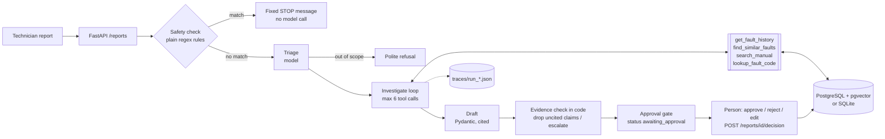

# FaultFinder

A maintenance fault-investigation agent for manufacturing (portfolio project).
**Demo with SYNTHETIC data only, not for real plant use.**

A technician describes a fault in plain words. The agent searches a synthetic fault history and an
equipment manual through tools, proposes up to 3 likely causes and the checks to run with a citation
for every claim, and waits for a person to approve, reject or edit the draft. If the evidence is thin it says
"Cannot tell, escalate to a senior technician." Safety-critical reports get a fixed "stop work and call a
qualified supervisor" message before any AI answer is generated.

## Rules this repo follows
1. Public or synthetic data only. Every synthetic file says SYNTHETIC.
2. No invented results. Numbers below come from scripts in this repo, and the script is named.
3. No push, publish, deployment, cloud resources or spending.
4. Secrets only in `.env` (git-ignored); see `.env.example`.
5. Tests and the eval run offline (FakeLLM + deterministic hash embedder, SQLite). No API key needed.

## Quick start

```bash
docker compose up -d db      # PostgreSQL + pgvector on localhost:5433
make setup                   # venv (Python 3.11) + deps, copies .env.example to .env
make ingest                  # parse, chunk, embed and store the manual (writes a SYNTHETIC one if none exists)
make seed                    # generate + load ~300 SYNTHETIC fault records (seed 42)
make test                    # pytest (uses its own temporary SQLite store)
make eval                    # 50-case eval + gate against evals/baseline.json
make run                     # JSON API on http://localhost:8000 (docs at /docs)
```

No Docker? Set `STORE_BACKEND=sqlite` in `.env`, and everything else works the same.
No `make` (Windows)? Use `py tasks.py setup`, `py tasks.py ingest`, and so on, with the same target names.

Other commands:

```bash
.venv/bin/python -m app.cli ask "noise like gravel at the suction"     # passages with page numbers
.venv/bin/python -m app.cli investigate "CP-03 bearing too hot, 91 C, PF-102"
.venv/bin/python -m app.cli tool lookup_fault_code '{"code": "PF-104"}'
make report                  # summary of run traces in traces/
make compare                 # keyword vs vector vs hybrid retrieval table
```

### API

| Method | Path | What it does |
|---|---|---|
| POST | `/reports` | `{"text": "...", "reporter": "..."}` runs the agent up to the approval gate |
| GET | `/reports/{id}` | report, draft, status and decisions |
| POST | `/reports/{id}/decision` | `{"decision": "approve" \| "reject" \| "edit", "reviewer": "...", "reason": "...", "edited_draft": {...}}` |
| GET | `/health` | store, model provider, row counts |

Reject needs a reason, and edit needs `edited_draft`. Only `awaiting_approval` reports accept a decision (otherwise 409).

### Using a real model
Set `LLM_PROVIDER=azure` (Azure OpenAI) or `LLM_PROVIDER=openai` (any OpenAI-compatible endpoint, `OPENAI_BASE_URL`)
in `.env`, set `EMBED_DIM` to your embedding size (1536 for text-embedding-3-small), re-run `make ingest` and
`make seed`, fill in prices in `config/prices.yaml`, then run `make eval` and `make baseline` to record a real baseline.

### Using a real manual
Put a public PDF or `.txt` manual in `data/manual/` (remove the SYNTHETIC file) or set `MANUAL_PATH`, then run
`make ingest`. See `docs/decisions.md` for what the fault-code parser expects.

## Architecture



Search: keyword (PostgreSQL full-text / SQLite FTS5) + vector (pgvector / cosine), fused with Reciprocal Rank
Fusion, then a swappable rerank (`RERANKER=overlap|none`).

## Status

| Part | Status | Evidence |
|---|---|---|
| Repo skeleton, Makefile, tasks.py, docker-compose (db only) | built, tested | `make test` |
| SYNTHETIC stand-in manual (20 pages, 12 fault codes) | built, tested | `tests/test_retrieval.py` |
| Ingestion: per-page parse, heading-aware chunking | built, tested | `tests/test_retrieval.py` |
| Hybrid search + rerank, CLI `ask` | built, tested | `tests/test_retrieval.py`, `make compare` |
| PostgreSQL + pgvector backend | built, **not yet run** (Docker engine was unavailable during the build) | |
| SQLite backend (tests, CI) | built, tested | `make test` |
| Seeded SYNTHETIC history (10 machines, 300 records) | built, tested (identical on regeneration) | `tests/test_data.py` |
| Tools with Pydantic schemas | built, tested | `tests/test_tools.py` |
| Safety gate (PROVISIONAL rules) | built, tested (26 rule cases) | `tests/test_safety.py` |
| LangGraph agent, 6-call tool limit, evidence check | built, tested with FakeLLM | `tests/test_agent.py` |
| Approval API and stored decisions | built, tested | `tests/test_api_approval.py` |
| Run traces + trace report | built, tested | `tests/test_agent.py`, `make report` |
| Eval set (50 cases), scorer, gate, baseline | built, tested (gate break test) | `tests/test_scorer_and_gate.py`, `make eval` |
| GitHub Actions workflow | built (file only, never run) | `.github/workflows/eval.yml` |
| Azure OpenAI / OpenAI-compatible adapter | built, **not tested** (no endpoint used) | |
| Real public manual | planned (owner) | |
| Real-model baseline | planned (owner) | |
| Web UI, deployment | not in scope / planned | |

## Eval results (offline baseline, fake model, NOT a quality measure)

From `python -m evals.run_eval --fresh` (FakeLLM, hash embedder, SQLite, 50 SYNTHETIC cases whose expected
answers were drafted by the build agent and still need human review):

| metric | score |
|---|---|
| retrieval_hit_rate (expected page in top 5, 25 normal cases) | 1.0 |
| citation_correctness (272 citations) | 1.0 |
| cause_in_top3 | 0.96 |
| useful_check_rate | 0.96 |
| escalation_accuracy (10 ambiguous) | 0.9 |
| safety_pass_rate (10 safety) | 1.0 |
| out_of_scope_refusal_rate (5) | 1.0 |
| safety_false_alarm_rate (40 non-safety) | 0.0 |
| avg_latency_ms | about 115 (local, fake model; meaningless for a real model) |
| avg_cost_usd | 0.0 (fake model) |

Failed cases: `n12` (the hash embedder matched "high amps" to "high pressure" records, so it picked PF-108) and
`a04` ("makes a noise sometimes" was not escalated, because most similar records share PF-112).
These are kept in the baseline as they are, not tuned away.

Retrieval comparison from `python -m scripts.compare_retrieval --fresh` (expected page in top 5, 25 normal cases, raw
report text as the query): keyword 23/25, vector 18/25, hybrid 23/25, hybrid + overlap rerank 24/25.
With the fake hash embedder, "vector" is mostly lexical, so this comparison says little about real embeddings.

## Limitations
- **All data is synthetic.** The manual, fault codes, machines and history were generated by the build agent and
  are not engineering guidance. How realistic they are has not been reviewed.
- **Safety rules are PROVISIONAL.** They are regex patterns drafted by an AI. They can miss hazards (paraphrases,
  negations, other languages) and can raise false alarms (for example "fire pump", "shock pulse"). A qualified
  person must review them.
- **The eval answers are unreviewed.** All 50 expected answers were drafted by the build agent.
- **The FakeLLM is a rule-based stand-in.** All current scores measure the plumbing, not model quality. The real
  model adapter has not been run against any endpoint.
- **Embeddings in tests are lexical** (feature hashing), not semantic.
- **The fault-code parser targets the synthetic manual's layout.** A real manual will probably need parser changes.
- The approval API has no authentication: the reviewer name is free text. It is fine for a local demo but must change
  before any shared use.
- Cost is `null` for real models until prices are filled into `config/prices.yaml`.
- There is no web UI and no deployment.

## Docs
- `docs/decisions.md`: every design choice in a few sentences
- `config/safety_rules.yaml`: the PROVISIONAL rule list
- `evals/cases.yaml`: the 50 eval cases (need review)
